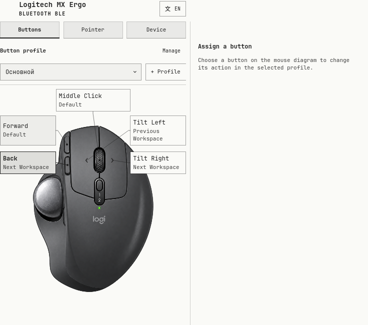
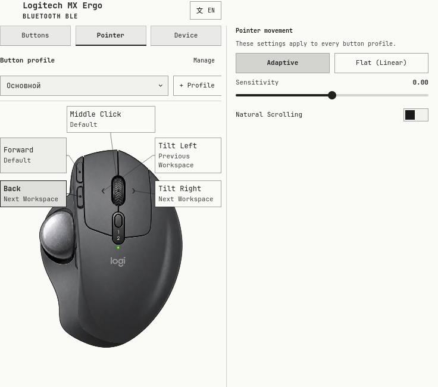
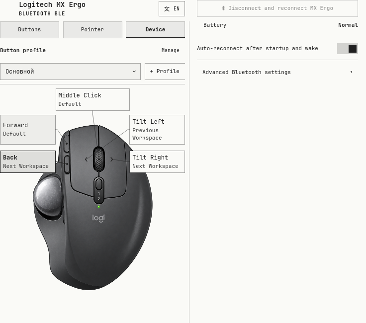
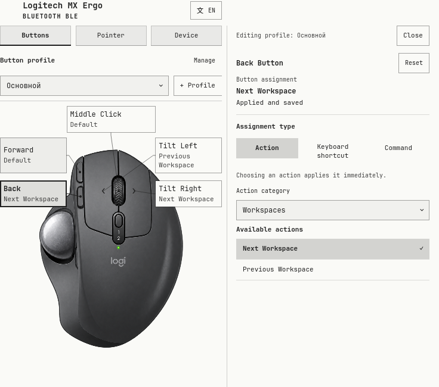
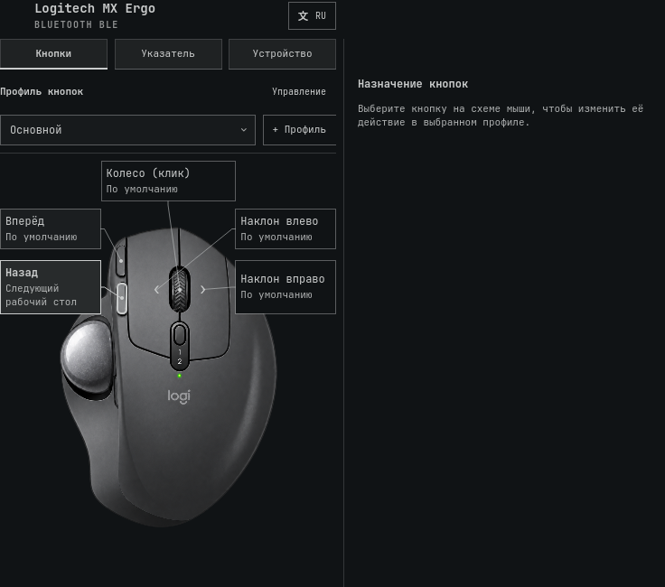
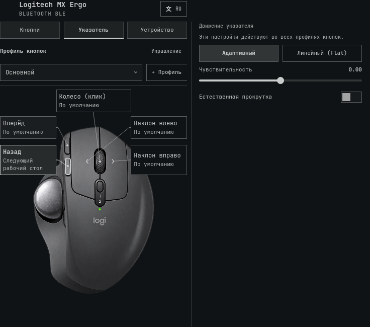
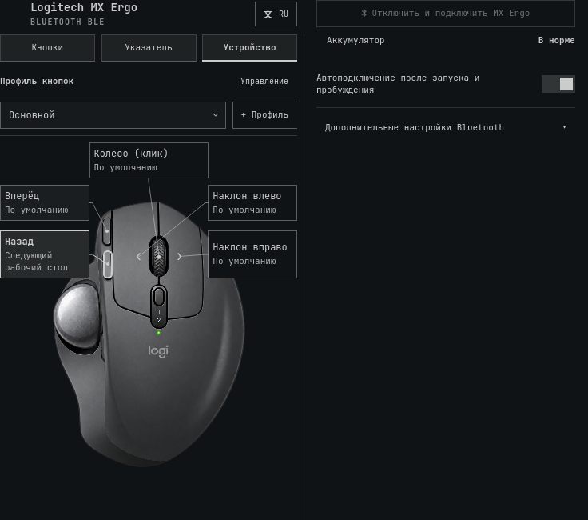
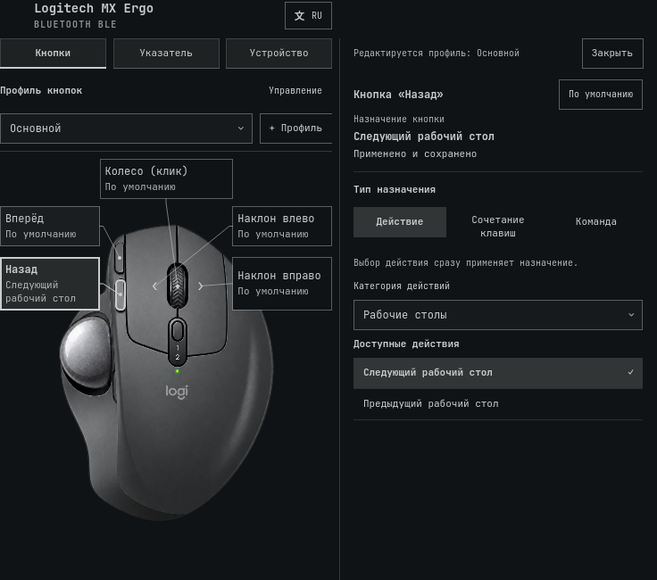

> Documentation snapshot: detailed usage preserved from the pre-hygiene README. Earlier review and screenshot evidence is historical; current check status is in [BACKLOG.md](../BACKLOG.md).

# Logitech MX Ergo Trackball Plugin for Omarchy Quattro

> **Status: Work in progress / В разработке.** This is a development snapshot, not a stable release. The manifest currently reports `1.0.0`; that number does not indicate production readiness. See [known limitations](#known-limitations) before trying it.

A hardware plugin for Omarchy Quattro shell designed for the **Logitech MX Ergo** multi-device wireless trackball connected via Bluetooth BLE or Logitech Unifying Receiver.

<a href="../preview.png"></a>

## Screenshots

These are current captures of the actual `ErgoPanel.qml` consumer at 736 × 650,
using inert example data, installed shell controls and controlled palettes. They
show layout and text; they do not verify live desktop placement or hardware state.
See [capture provenance](../assets/screenshots/current/evidence.json). Earlier supplied
captures and 2× rerenders remain archived in `assets/screenshots/original/` and
`assets/screenshots/qml-2x/`; they show the previous layout.

### Light theme

<table>
  <tr>
    <td><strong>Buttons</strong><br><a href="../assets/screenshots/current/light-buttons.png"></a></td>
    <td><strong>Pointer</strong><br><a href="../assets/screenshots/current/light-pointer.png"></a></td>
  </tr>
  <tr>
    <td><strong>Device</strong><br><a href="../assets/screenshots/current/light-device.png"></a></td>
    <td><strong>Button editor</strong><br><a href="../assets/screenshots/current/light-editor.png"></a></td>
  </tr>
</table>

### Dark theme

<table>
  <tr>
    <td><strong>Buttons</strong><br><a href="../assets/screenshots/current/dark-buttons.png"></a></td>
    <td><strong>Pointer</strong><br><a href="../assets/screenshots/current/dark-pointer.png"></a></td>
  </tr>
  <tr>
    <td><strong>Device</strong><br><a href="../assets/screenshots/current/dark-device.png"></a></td>
    <td><strong>Button editor</strong><br><a href="../assets/screenshots/current/dark-editor.png"></a></td>
  </tr>
</table>

## Features

- **Native Battery Services:** Reactive battery state from Quickshell UPower and Bluetooth. Kernel metadata identifies the selected MX Ergo; its coarse `capacity_level` supplies the UPower category.
- **Battery Reporting:** Shows the reported level (High, Normal, Low, or Critical), Charging, or Charge unknown when no level is available. A short hint identifies the level as approximate. When HID++ and Bluetooth disagree, the panel shows both source-labelled categories. No filled battery gauge or synthetic percentage is displayed.
- **Device Matching:** Bluetooth batteries must match the selected device address. A sole MX Ergo on Unifying is selected when there is no active Bluetooth link; a cached BLE battery is never treated as a receiver connection.
- **Hardware Button Mapping:** Configures actions for 5 trackball buttons (`mouse:275`, `mouse:276`, `mouse:274`, `mouse:278`, `mouse:279`) with action catalog (Workspaces, Overview, Window control, Audio mute).
- **Button Profiles:** Named independent sets of all five assignments, with Add, Rename and Delete on the Buttons page. Existing assignments become Main. Switch from the selector, a configurable keyboard shortcut, or the Next profile mouse action. The active name also appears in the bar tooltip.
- **Experimental Low-Latency Mode:** Optional kernel BLE connection parameter tuning (`conn_min_interval: 6`, `conn_max_interval: 9`) and USB autosuspend settings. Actual input rate and latency have not been measured.
- **Settings Persistence:** Button mappings and pointer preferences are saved to `$XDG_CONFIG_HOME/omarchy/mx-ergo.json` (default: `~/.config/omarchy/mx-ergo.json`). Writes are serialized and atomically replace the file; failures leave the previous file intact. Loading is capped at 64 KiB and validates types, ranges and action names. Invalid preferences are not applied. Read, write and settings-application failures appear in the panel; failed saves or applications have an explicit Retry action.
- **Theme Changes:** After Hyprland reloads its configuration, the plugin reapplies current settings through its native `configreloaded` event. One managed helper applies the settings and verifies button keys, descriptions, and removed default mappings in Hyprland. Failures receive at most three attempts with 2- and 4-second delays; each command has a 5-second timeout. Changes made while an attempt is running replace the pending request. Verification failures appear in the panel and shell log. This does not continuously monitor mappings removed later by another application, or prove what originally removed a mapping.
- **Button Diagram:** Select a physical button or its callout on the MX Ergo illustration to open its editor. Labels show current assignments in larger theme text. Preset names are written in full; long user shortcuts or commands have a bounded diagram summary and full text in the editor. Selection alone does not change mappings. Both wheel tilts and middle-click have separate targets.
- **Language Selector:** The header shows a translation symbol and the effective language code, including in automatic mode. The list uses native language names and highlights the selected preference. Tab reaches the picker and each language; Escape closes the list first. Unsupported Traditional Chinese locales fall back to English.
- **Panel Layout:** All three pages share a `Style.space(736)` by `Style.space(650)` frame, fitted to the screen by the existing host. The fixed header and page tabs stay above scrolling content. Button profiles and the full-size mouse remain on the left; assignment guidance/editor, Pointer settings and Device details use the right column. Page changes, editor open/close, forms and status text do not resize the card. Columns scroll independently, including keyboard focus navigation. Recovery is in the right header on Device; active cancellation remains available on every page. The editor labels assignment type, action category and available actions. Close, Escape, unused-background click and repeated diagram selection dismiss it.
- **Explicit Editing:** Typing, recording, clearing, or composing a shortcut changes only the draft. Apply or Enter saves shortcuts and commands; leaving the editor discards unapplied drafts. Selecting a preset or Reset applies immediately. Explicit choices keep the editor open and update the highlighted mouse control. Clicking another control loads its saved assignment and discards the previous unapplied draft. Tab moves through editor controls, including key chips.
- **Assignment feedback:** The adjacent editor labels the selected assignment and separates unapplied drafts from application and saving. “Applied and saved” requires helper verification of the latest settings and confirmed preference storage, with no pending work or error. Errors offer the existing Retry action. This confirms compositor settings and storage; it does not prove a physical mouse button event.
- **Compact Status Indicator:** Trackball connection state and charging indicator in the Omarchy status bar.
- **Strict Uncertainty Handling:** Disconnected or sleeping states display explicit indicator glyphs without coercing unknown battery levels to 0%.
- **Hyprland Pointer Controls:**
  - Acceleration profile toggle: **Adaptive** vs **Flat** (Linear).
  - Sensitivity slider (`-1.0` to `+1.0`, step `0.05`) with a one-shot 250ms debounce.
  - Natural scrolling toggle.
  - Per-device pointer configuration applied directly to `logitech-mx-ergo-multi-device-trackball-`.
- **Pure Theme Integration:** 100% Omarchy theme tokens (`Color.*`, `Style.*`), automatically matching any active desktop palette.

## Button profiles

On **Buttons**, select a profile above the mouse diagram. **+ Profile** creates an
independent copy of the current five assignments; give it a name and edit its
buttons. **Manage** reveals Rename and Delete. Rename changes the active profile's
name. Delete asks for confirmation
and activates another profile before removing the current one; the last profile
cannot be deleted. Pointer and Bluetooth preferences are shared.

Profile management and its forms open beside the mouse in the right column;
the selector and mouse keep their position. Pointer explicitly describes its
settings as shared. On Device, **Advanced Bluetooth settings** discloses the
optional controller profile. Expanding/collapsing changes only presentation;
pending/error summaries remain visible when its details are collapsed.

In a button's **Presets** editor, select an **Action category**, then choose an
action from the list. Changing categories does not change the assignment. Choose
**Next profile** in the System category to cycle through profiles in
list order. In that button's editor, choose **Use this button to switch in
all profiles** to keep the same switching button in every profile. Newly created
profiles copy that assignment too. **Manage → Switch shortcut** records or accepts a
separate keyboard combination; it is initially disabled. Clear and Apply disables
it. Existing keyboard bindings, including matching combinations in named submaps,
are not replaced. Code-based bindings with the same modifier mask are treated as
potential conflicts because their symbol cannot be resolved from binds JSON.

All entry points use the same model operation. The command for an external
shortcut is:

```bash
omarchy-shell io.github.pavellizunov.mx-ergo nextProfile
```

`omarchy-shell io.github.pavellizunov.mx-ergo profileStatus` returns the current
profile ID/name, count, action IDs and application state as JSON. `verified` confirms the latest helper readback; `pending` and `savePending` include queued work, and `saved` confirms preference storage without pending work or errors. It does not
return custom command text or modify settings.

Physical mouse buttons and the keyboard switch on release without key repeat.
Horizontal wheel tilts use an axis event; another tilt switch is admitted only
after 750 ms without a new pulse. Switches while application is in progress are
ignored, and duplicate requests within 250 ms are ignored. The editor returns to
the diagram if an external shortcut changes profiles, discarding its draft.

The active profile changes after Hyprland readback confirms its assignments.
Failure attempts one bounded restoration of the previous profile. A failed
restoration is explicitly unverified; Retry reapplies the requested switch.
Keyboard conflicts leave the saved shortcut unchanged. Readback checks keys,
descriptions, release/repeat flags and Lua callback IDs for switching actions;
it cannot decode Hyprland's Lua callback to prove the resulting external command
ran. Physical button behavior must still be checked on hardware.

Preferences use version 2 with `profiles`, `activeProfileId` and
`profileShortcut`. Each profile contains a stable ID, name, and the existing
`buttons`, `customShortcuts` and `customCommands` maps. The old single-set format
is read without rewriting it at startup; the next successful edit/save writes
version 2. Up to 32 profiles are supported, with names of 1–80 characters and a
64 KiB total file limit. An invalid configuration is preserved. Older plugin
versions cannot load the new format; retain a backup before downgrading.

## Architecture & Security Disclosure

- **Execution:** The plugin runs unsandboxed with the user's permissions inside the shared Omarchy shell. Button actions can execute commands and change Hyprland bindings.
- **Optional Privileges:** The plugin never elevates its own mutable scripts. The unprivileged client checks the installed helper and its ancestors for root ownership, safe modes and absence of symlinks. Explicit profile actions authorize only `/usr/local/libexec/omarchy-mx-ergo-bluetooth` through Polkit. A separate installation is required; the normal plugin works without it. The profile affects every device on the controller.
- **Kernel Metadata:** Native `FileView` objects read each UPower device’s HID identity from `device/uevent` and coarse charge category from `capacity_level`. Connection status remains in the native Bluetooth service. No raw `/dev/hidraw*` access.
- **Processes:** A bounded Python helper validates and atomically writes settings; optional controller diagnostics use Bash; pointer and button settings use `hyprctl eval`. The custom command field intentionally runs shell commands as the user. Shortcut operands are shell-quoted. No plugin network calls, downloads or remote builds are performed.
- **Monitoring:** Resume detection uses one managed `dbus-monitor` subscription restricted to the logind sender, path and sleep signal. An unexpected exit receives at most three retries, spaced by two seconds; a stopped listener is reported in the panel. Sleep cancels pending reconnect timers and the current settings helper; resume reapplies configured assignments. A second wake reconnect attempt waits for the first Connect to settle and expires after 60 seconds. Battery changes arrive through native services; no battery polling process runs. Controller diagnostics run on panel open and after an authorized profile operation.
- **Strict Input Validation:** Hardware addresses are strictly validated against MAC address patterns before passing to Bluetooth brokers.

## Setup and development

Requires Omarchy Quattro, its Quickshell Bluetooth and UPower modules, BlueZ with `bluetoothctl` (bluez-utils), UPower, and the Hyprland Lua interface used by this source. Runtime helpers include Python 3, `dbus-monitor`, and `hyprctl`. Some button actions additionally require `wtype`, `playerctl`, `wpctl`, Voxtype, the `moorgrove.overview` plugin, or the `io.github.hikari112.tts` plugin. Tests require Node.js, Python 3, Lua, Qt 6 `qmllint` and `qmltestrunner` (including QtTest and QtQuick.Shapes), and installed Omarchy shell sources.

For source inspection, clone outside the active plugins directory:

```bash
git clone https://github.com/PavelLizunov/omarchy-mx-ergo.git
cd omarchy-mx-ergo
```

Plugin assets and helpers resolve relative to their QML source; the checkout folder name is not significant. The Bluetooth address is blank by default: the plugin selects a single MX Ergo, the only connected bonded one, or the only bonded one when several records share that name. It remembers that choice until the model reloads. Set `deviceAddress` explicitly for a stable selection when several records exist; if that record disappears, the panel reports it missing instead of silently switching to a same-name address. Pairing is handled outside the plugin. The connection indicator follows BlueZ `Connected`; the panel separately shows incomplete pairing when `Paired` or `Bonded` is absent. Even a bonded link is labelled as a Bluetooth report, not proof of pointer movement. Automatic reconnection requires an existing bond. With **Auto-reconnect after startup and wake** enabled, the plugin makes one bounded scan-and-connect attempt after startup if the selected bond is disconnected. It never disconnects a reported connection automatically, and it does not repeat discovery after a later ordinary disconnect. If the mouse is not advertising during that startup window, use the manual action.

For a new Bluetooth pairing, put the selected Easy-Switch channel into its fast-blinking mode, start `bluetoothctl` and `scan le`, then run `pair <address>` as soon as the MX Ergo appears. Stop your scan with `scan off` and check `info <address>` for `Paired: yes` and `Bonded: yes`. In the installed Omarchy version, the Bluetooth helper continues to `trust` and `connect` after a failed `pair`, and its panel accepts `Connected` alone as success. This can present an unpaired link as connected. `Trusted` or `Connected` alone does not confirm a usable mouse.

**Connect Trackball** uses the existing bonded BlueZ device. When BlueZ reports it connected but the mouse does not work, **Disconnect and reconnect MX Ergo** remains available: it disconnects only that mouse after the click, waits for BlueZ to confirm disconnection, and starts its own bounded LE discovery session. It connects the saved bond on a fresh report of that address or after a 10-second scan warm-up; the scan lasts no more than about 45 seconds after startup. While active, the action becomes **Cancel recovery**. If Connect is already in progress, cancellation asks BlueZ to stop that address's connection and waits for the result; the panel reports when cancellation cannot be confirmed. The panel separately reports whether its discovery output showed the saved address and whether BlueZ reported a link. Another MX Ergo address is diagnostic only: the plugin never pairs it or changes `deviceAddress`. An existing scan remains under its original owner. Recovery requires exactly one Bluetooth adapter because `bluetoothctl scan le` chooses its own default adapter. A reported link still needs a pointer-movement check. If the saved record is absent or the attempt fails, inspect its `Paired` and `Bonded` state before pairing again. Pointer configuration uses `hyprDeviceName`, which must match the name reported by `hyprctl devices`. Files copied into the active plugin directory may be discovered or reloaded by the running shell. Never change or reload an active plugin while the screen is locked or a lock is requested.

On the tested Omarchy host, a plugin rescan can reuse cached QML after a source edit. If an update appears ineffective, restart the shell once while unlocked with `omarchy restart shell` (the bar briefly disappears). Verify that `quickshell log -p /usr/share/omarchy/shell -t 50` contains `MX Ergo: model loaded with categorical battery display and Hyprland reload recovery`. Subsequent Hyprland configuration reloads should log `MX Ergo: restoring settings after Hyprland reload` and restore the mappings automatically.

The plugin ID is `io.github.pavellizunov.mx-ergo`. Use Omarchy's plugin controls to enable or disable it. Before removal, use **Restore original settings** and resolve any pending restoration. Removing the plugin alone does not uninstall the optional helper or remove its system configuration. Saved preferences remain in `~/.config/omarchy/mx-ergo.json`.

## Installation and removal

This plugin runs unsandboxed with the user's permissions inside the shared Omarchy shell. Review the source, dependency list, and command behavior above before enabling it.

Install and enable the plugin with Omarchy's plugin manager:

```bash
omarchy plugin add https://github.com/PavelLizunov/omarchy-mx-ergo.git --enable
```

Update an installed copy with `omarchy plugin update io.github.pavellizunov.mx-ergo`. This follows the repository's current default branch; it does not pin a Marketplace-reviewed commit.

Before removal, restore the optional Bluetooth profile in the Device page and wait until its state is **Off** with no pending restoration. Disable the plugin, then reload the normal Hyprland configuration to restore configuration-defined button mappings. Remove the plugin with:

```bash
omarchy plugin remove io.github.pavellizunov.mx-ergo
```

The optional helper is installed and removed separately; see [Removing the optional helper](#removing-the-optional-helper). Plugin removal does not delete saved preferences or revert arbitrary commands run through the custom Command action.

## Known limitations

- Text appearing over the plugin has been reported; the cause and fix are pending.
- Verified charge measurement is unavailable. Source reports are approximate and measurement time is unknown. The installed Quickshell API does not expose UPower’s `BatteryLevel`; the plugin reads the matched HID power supply’s `capacity_level` and combines it conservatively with BlueZ’s report. UPower’s icon alone is not a charge category. Neither source proves a fresh hardware measurement or battery health. An unchanged High level cannot rule out discharge.
- UPower association requires readable HID metadata and exactly one matching identity. Unknown or ambiguous identity is not guessed. Without an active Bluetooth link, a sole receiver-side MX Ergo can be selected by product ID; multiple receivers require an explicit HID serial in `deviceAddress`. The Bluetooth MAC cannot prove which receiver-side serial belongs to the same physical mouse. Wireless sleep/connection through a receiver is not independently verified.
- Pointer settings are per input device, but Hyprland button bindings are global: these five button codes and two horizontal-wheel aliases affect other pointing devices too. Applying settings replaces unmodified bindings for those codes. Disabling/removing the plugin does not immediately undo runtime bindings; reload the Hyprland configuration after disabling to restore configuration-defined mappings. Unsaved mappings from other programs cannot be recovered automatically.
- Several recorded shortcuts use compatibility aliases: Insert starts Voxtype, Super+Insert starts the voice agent, and Super+Alt+A/E/X/R calls the installed TTS plugin. Common Super workspace/window shortcuts use compositor dispatchers. Other shortcuts use `wtype`; these aliases are not discovered from your keyboard configuration. The TTS path follows `XDG_CONFIG_HOME` rather than an author home directory.
- Runtime lifecycle and compatibility across machines have not been verified for this publication.

Development tasks are tracked in [BACKLOG.md](../BACKLOG.md).

## Optional Bluetooth latency profile

This changes controller defaults and USB autosuspend, not radio transmit power. No measured input rate or improvement in stuttering is guaranteed. Existing connections may retain their negotiated intervals. Battery, button mapping and pointer controls work without the optional helper.

### Installation (administrator action)

Review `system/omarchy-mx-ergo-bluetooth`, its Polkit policy, and `scripts/install-bluetooth-helper.sh` before running the installer from this checked-out version:

```bash
sudo ./scripts/install-bluetooth-helper.sh
```

The installer adds only a root-owned helper in `/usr/local/libexec` and `io.github.pavellizunov.mx-ergo.bluetooth.policy` in `/usr/share/polkit-1/actions`. It does not change Bluetooth settings, configure passwordless access, or start a daemon. Existing installations are refused rather than silently overwritten. The policy requires administrator authentication for the active session. Installing and updating administrator-owned code is a separate trust decision from enabling a user plugin.

### Operation and recovery

`scripts/low-latency.sh --status hci0` is read-only; use `-` when no adapter is available. It reports helper availability, saved profile state, and whether recovery is possible. The UI refreshes this on panel open. Unprivileged debugfs reads may be unavailable, so an installed profile can remain **Unable to verify** rather than falsely appearing applied. Authorization failures are shown separately from profile state.

- **Enable profile** saves the actual minimum/maximum interval and USB power mode once, then applies 6/9 interval units and USB `on`. Repeat enable never replaces the original baseline.
- The root-owned journal is `/var/lib/omarchy-mx-ergo/bluetooth.json`. A bounded udev invocation in `/etc/udev/rules.d/70-omarchy-mx-ergo-bluetooth.rules` reapplies an enabled profile when a Bluetooth adapter is added. It verifies physical USB port, vendor/product and serial (when provided), not just `hciN`. There is no persistent helper process. If debugfs is unavailable during the event, reapplication can fail; status reports that uncertainty.
- **Restore original settings** removes the owned activation rule first. If the original adapter is unavailable, the journal remains with **restore pending**; select Restore again after reconnecting it. Missing controls or reload failures retain recovery information. Values changed externally are not overwritten automatically.
- Errors during enable attempt restoration. Recovery information is removed only after original values and rule reload are verified. Root-owned files with unexpected contents, symlinks or insecure permissions are refused.
- One adapter profile is supported. Moving an adapter to another USB port requires recovery at the original port first. Devices without USB serial numbers cannot be distinguished from an identical replacement at the same physical port.

### Legacy profile migration

Older versions wrote `bluetooth-low-latency.conf` and `50-bluetooth-performance.rules` without saving original settings. **Remove old rules** explicitly deletes only recognized historical content and records that the original values are unknown. It does not invent a baseline or overwrite current controller values. Restart the computer before enabling a new profile; same-boot activation is refused. Unrecognized old files require manual review. Cleanup does not restart Bluetooth or disconnect the mouse automatically.

### Removing the optional helper

First restore the profile (or complete legacy cleanup and restart). Do not remove a pending recovery journal until the original adapter's settings have been restored. When the status is Off and there is no pending recovery, an administrator can remove the helper and its policy:

```bash
sudo rm -- /usr/local/libexec/omarchy-mx-ergo-bluetooth /usr/share/polkit-1/actions/io.github.pavellizunov.mx-ergo.bluetooth.policy
```

The inactive journal directory/lock can remain; neither executes code. Reinstalling or upgrading the helper requires deliberate administrator action. Privileged installation, actual udev hotplug behavior and controller writes must be verified separately on the target system; isolated tests are not a live security certification.

## Verification

```bash
./tests/run.sh
```

The suite checks the manifest, symlinks, colors, model contracts, locale completeness, QML lint, offscreen Qt interaction tests for the diagram, and lockscreen guard logic. Passing these checks does not verify live UI behavior. Model tests execute production JavaScript functions; component tests use Qt offscreen. See [release review](../RELEASE-REVIEW.md) for the checked scope and remaining acceptance work.

## License

MIT License. Copyright (c) 2026 Pavel Lizunov.

The custom trackball icon uses the approved simplified B silhouette and the active theme color. See [icon details](../assets/README.md).
